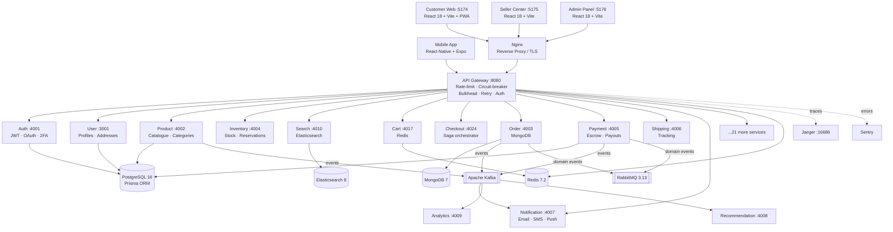

# MUNI — Uganda E-Commerce Marketplace

<div align="center">

**A production-grade, multi-seller e-commerce marketplace built for the Ugandan market.**

*Connecting customers with sellers across Uganda — pay with MTN Mobile Money, Airtel Money, Visa, Flutterwave, or Pesapal.*

</div>

---

## Table of Contents

1. [Project Overview](#1-project-overview)
2. [Project Objectives](#2-project-objectives)
3. [Key Features](#3-key-features)
4. [System Architecture](#4-system-architecture)
5. [Technology Stack](#5-technology-stack)
6. [Repository Structure](#6-repository-structure)
7. [Backend Services](#7-backend-services)
8. [Frontend Applications](#8-frontend-applications)
9. [Mobile Application](#9-mobile-application)
10. [Database Architecture](#10-database-architecture)
11. [Authentication & Authorization](#11-authentication--authorization)
12. [Payment Integrations](#12-payment-integrations)
13. [API Gateway](#13-api-gateway)
14. [Messaging & Event Processing](#14-messaging--event-processing)
15. [Prerequisites](#15-prerequisites)
16. [Local Development Setup](#16-local-development-setup)
17. [Environment Variables](#17-environment-variables)
18. [Database Setup & Migrations](#18-database-setup--migrations)
19. [Running Individual Applications](#19-running-individual-applications)
20. [Running the Complete Project](#20-running-the-complete-project)
21. [Docker Setup](#21-docker-setup)
22. [Testing](#22-testing)
23. [API Documentation](#23-api-documentation)
24. [Deployment](#24-deployment)
25. [Security Considerations](#25-security-considerations)
26. [Troubleshooting](#26-troubleshooting)
27. [Development Guidelines](#27-development-guidelines)
28. [Contributing](#28-contributing)
29. [Roadmap](#29-roadmap)
30. [License](#30-license)

---

## 1. Project Overview

MUNI is a production-grade, multi-sided e-commerce marketplace designed specifically for the Ugandan market. It provides a platform for product discovery, shopping, payments, order management, and marketplace administration. The platform integrates with Uganda's dominant mobile money providers — MTN Mobile Money and Airtel Money — alongside international card payments, making it accessible to the broadest possible customer base.

The monorepo contains:

- **3 frontend web applications** (Customer, Seller, Admin) built with React + Vite
- **1 mobile application** built with React Native + Expo
- **35 backend services** (34 application microservices + 1 API gateway) in TypeScript/Node.js
- **Full Docker Compose stack** for local development and production deployment
- **Kubernetes manifests** for cloud deployment (AWS EKS, targeting `af-south-1`)
- **CI/CD pipelines** via GitHub Actions

---

## 2. Project Objectives

- Provide Ugandan consumers with a trusted, locally-focused marketplace for phones, fashion, home goods, and groceries.
- Enable individual and business sellers to list products, manage inventory, and receive payouts through local payment channels.
- Build a scalable microservices platform that can serve Uganda and expand regionally.
- Integrate natively with MTN Mobile Money and Airtel Money — the dominant payment methods in Uganda.
- Provide administrators with full control over seller onboarding (KYC), disputes, platform finances, and content moderation.

---

## 3. Key Features

### Customer Features
- Browse and search products across multiple sellers and categories
- Product recommendations and personalized discovery
- Shopping cart (Redis-backed, session-persistent)
- Wishlist management
- Multi-seller checkout with order splitting per vendor
- Payment via MTN Mobile Money, Airtel Money, Visa/Mastercard (3DS2), Flutterwave, and Pesapal
- Escrow-protected payments — funds held until delivery confirmed
- Real-time order tracking with carrier and tracking number
- Product reviews and Q&A
- Returns and refund requests (14-day window from delivery)
- Buyer Protection Program (dispute escalation)
- Real-time chat with sellers (Socket.io)
- Loyalty rewards program
- Newsletter subscription
- Currency display (UGX)
- Progressive Web App (PWA) with offline support (customer web)
- GDPR-compliant data export and account deletion

### Seller Features
- Seller registration with KYC document upload (national ID, passport, business registration, bank statement)
- Admin-verified seller onboarding
- Product and variant management
- Bulk product import via CSV/Excel
- Inventory management with low-stock alerts
- Order fulfillment and shipment tracking
- Earnings dashboard, transaction ledger, and withdrawal requests
- Seller finance statements
- Advertising campaign management
- Seller education resources
- Real-time chat with buyers
- Store profile with logo, banner, and slug
- Seller performance ratings and scorecard

### Administrator Features
- Seller KYC review and approval/rejection queue
- Platform user management
- Order oversight
- Weekly payout processing to verified sellers
- Platform commission management
- Financial summary, withdrawal queue review (approve/reject/settle)
- Dispute resolution
- Content moderation
- Newsletter management
- System health monitoring via Jaeger (tracing) and Kibana (logs)

### Mobile Application Features
- Full shopping experience on Android and iOS
- Product browsing, search, cart, and checkout
- Account management and order history
- Real-time push notifications (Expo Notifications)
- Seller store pages
- Internationalization (i18next)
- Sentry error tracking
- File-based routing via Expo Router

---

## 4. System Architecture

MUNI uses a microservices architecture. All client traffic routes through a single API gateway that handles authentication, rate limiting, circuit breaking, and proxying to downstream services.



### API Gateway Resilience

| Pattern | Configuration |
|---|---|
| **Rate limiter** | Redis sliding window; 100 req/60s (customer/anon), 1000 (seller), 5000 (admin) |
| **Circuit breaker** | Per-service; trips after 5 consecutive failures, opens for 30s, HALF_OPEN probe |
| **Bulkhead** | 20 concurrent for `payment`, 50 for all others; 100 waiters, 5s timeout → 503 |
| **Retry** | Up to 3 attempts; exponential backoff 1s→2s→4s, ±10% jitter; never retries 4xx |

---

## 5. Technology Stack

### Backend

| Layer | Technology |
|---|---|
| **Runtime** | Node.js 20 |
| **Language** | TypeScript 5.x |
| **Framework** | Express 4.x |
| **API Gateway** | Custom Express proxy (KafkaJS, Redis, Helmet, Sentry) |
| **ORM** | Prisma 5.x (PostgreSQL services) |
| **ODM** | Mongoose 8.x (MongoDB services) |
| **Validation** | Zod |
| **Logging** | Winston |
| **Tracing** | OpenTelemetry → Jaeger |
| **Error tracking** | Sentry (`@sentry/node`) |
| **Task queues** | BullMQ (product imports, inventory expiry) |

### Databases & Brokers

| Technology | Version | Purpose |
|---|---|---|
| **PostgreSQL** | 16-alpine | Primary relational store (auth, product, payment, etc.) |
| **MongoDB** | 7.0 | Document store (orders, chat) |
| **Redis** | 7.2-alpine | Cache, cart, rate limiting, sessions, BullMQ queues |
| **Apache Kafka** | Confluent 7.6.1 | Durable event log (21 topics) |
| **RabbitMQ** | 3.13-management-alpine | Domain event bus with retry/DLQ pipeline |
| **Elasticsearch** | 8.13.4 | Full-text product search |

### Frontend

| Application | Stack |
|---|---|
| **customer-web** | React 18, Vite 5, Redux Toolkit, React Router 7, Socket.io-client, PWA (vite-plugin-pwa) |
| **seller-center** | React 18, Vite 5, Redux Toolkit, React Router 7, Recharts |
| **admin-panel** | React 18, Vite 5, Redux Toolkit, React Router 7, Recharts |

### Mobile

| Layer | Technology |
|---|---|
| **Framework** | React Native 0.86 |
| **Platform** | Expo SDK 57 |
| **Navigation** | Expo Router (file-based) |
| **State** | Redux Toolkit |
| **UI** | React Native Paper, Expo Vector Icons |
| **i18n** | i18next + react-i18next |
| **Error tracking** | Sentry React Native |
| **Builds** | EAS Build (Expo Application Services) |

### Infrastructure & DevOps

| Technology | Purpose |
|---|---|
| **Docker Compose** | Local development & single-server production |
| **Kubernetes** | Cloud production (AWS EKS, `af-south-1`) |
| **Nginx** | Reverse proxy, TLS termination, SPA serving |
| **Terraform** | Infrastructure-as-code (present in repo, not fully documented) |
| **Helm** | Kubernetes package management |
| **GitHub Actions** | CI/CD pipelines (CI, CD staging, CD production) |
| **AWS ECR** | Container image registry (production) |
| **Turborepo** | Monorepo task runner (build, test, lint, typecheck) |
| **Gitleaks** | Secret scanning in CI |

---

## 6. Repository Structure

```
muni/
├── frontend/
│   ├── customer-web/        # @muni/customer-web — customer storefront (port 5174)
│   ├── seller-center/       # @muni/seller-center — seller dashboard (port 5175)
│   ├── admin-panel/         # @muni/admin-panel  — platform admin (port 5176)
│   └── shared/              # Shared TypeScript clients (api-client, websocket-client, logger)
│
├── backend/
│   ├── api-gateway/         # @muni/api-gateway — HTTP proxy, rate-limit, auth (port 8080)
│   ├── services/            # 34 microservices (see §7)
│   │   ├── auth-service/
│   │   ├── product-service/
│   │   ├── payment-service/
│   │   └── ...
│   ├── shared/              # Shared backend modules
│   │   ├── http/            # CORS, auth middleware, validation middleware
│   │   ├── kafka/           # Kafka producer/consumer helpers
│   │   ├── rabbitmq/        # RabbitMQ topology & helpers
│   │   ├── security/        # Encryption, placeholder-secret detection
│   │   ├── observability/   # Sentry helpers
│   │   ├── utils/           # JWT token utilities
│   │   └── ...
│   ├── infrastructure/      # Infrastructure config
│   │   ├── database/        # Elasticsearch, MongoDB, Redis configs
│   │   ├── kafka/           # Topic definitions
│   │   ├── rabbitmq/        # Exchange/queue topology
│   │   ├── kubernetes/      # Kubernetes manifests (base, overlays, services)
│   │   ├── monitoring/      # Observability config
│   │   └── terraform/       # IaC (Terraform)
│   ├── migrator/            # One-shot Prisma migration init container
│   ├── e2e/                 # End-to-end tests (Playwright)
│   └── tests/               # Integration and load tests
│
├── mobile/                  # React Native app (standalone — NOT in npm workspaces)
│   ├── app/                 # Expo Router file-based routes
│   │   ├── (auth)/          # Login, register, forgot password
│   │   ├── (tabs)/          # Main tab navigator
│   │   ├── product/         # Product detail screens
│   │   ├── checkout/        # Checkout flow
│   │   ├── order/           # Order tracking
│   │   └── ...
│   └── src/                 # Shared mobile source (store, hooks, api, i18n)
│
├── nginx/                   # Nginx reverse proxy config
│   ├── nginx.conf           # HTTP config
│   └── nginx.ssl.conf       # HTTPS config (production)
│
├── scripts/                 # Developer and ops scripts
│   ├── setup-dev.sh         # Bootstrap: create .env, generate secrets
│   ├── db-setup.sh          # Apply Prisma migrations + seed
│   ├── promote-admin.sh     # Grant ROLE_ADMIN to a registered user
│   ├── backup-postgres.sh   # Scheduled PostgreSQL backup
│   ├── restore-postgres.sh  # PostgreSQL restore
│   ├── deploy.sh            # Production deploy helper
│   └── init-letsencrypt.sh  # Let's Encrypt TLS certificate bootstrap
│
├── docs/                    # Additional documentation
│   ├── Architecture_Diagram.md
│   ├── API_Documentation.md
│   ├── Deployment_Guide.md
│   ├── DEPLOYMENT.md        # Production deploy & rollback runbook
│   └── DISASTER_RECOVERY.md
│
├── docker-compose.yml       # Authoritative full-stack compose file
├── docker-compose.debug.yml # Debug/override compose file
├── turbo.json               # Turborepo pipeline config
├── package.json             # Root workspace (npm workspaces + Turborepo)
└── .env.example             # Root environment template
```

> **Note on mobile:** The `mobile/` directory is intentionally **not** part of the npm workspaces. React Native requires its own isolated `node_modules` and Metro haste map. Install and run it standalone (see [§19](#19-running-individual-applications)).

---

## 7. Backend Services

All 34 microservices plus the API Gateway are written in TypeScript and Express. Each has its own `package.json`, `Dockerfile`, `.env.example`, and Prisma schema (where applicable). The root `docker-compose.yml` is the single authoritative compose file.

| Service | Port | Database / ORM | Responsibility |
|---|---|---|---|
| **api-gateway** | 8080 | Redis (rate-limiter) | HTTP reverse proxy; JWT verification; rate limiting; circuit breaking; bulkhead; retry |
| **auth-service** | 4001 | PostgreSQL / Prisma | User registration & login; JWT access + refresh tokens; 2FA (TOTP); OAuth (Google, Facebook, Apple); KYC document upload; seller profile |
| **user-service** | 3001 | PostgreSQL / Prisma | Address book; notification preferences; seller trust score |
| **product-service** | 4002 | PostgreSQL / Prisma + Elasticsearch + MongoDB | Product catalogue; variants; categories; bulk CSV/Excel import (BullMQ); Elasticsearch indexing |
| **inventory-service** | 4004 | PostgreSQL / Prisma (shares `muni_products`) | Stock reservation; low-stock alerts; expiry sweeper (BullMQ + Redis) |
| **search-service** | 4010 | Elasticsearch | Full-text search; filters; facets |
| **cart-service** | 4017 | Redis | Shopping cart; session persistence |
| **checkout-service** | 4024 | — | Checkout saga orchestrator; price validation; stock reservation; payment initiation |
| **order-service** | 4003 | MongoDB / Mongoose | Order lifecycle; sub-orders per seller; fulfillment status; tracking number; shipment state machine |
| **payment-service** | 4005 | PostgreSQL / Prisma | Payment initiation; escrow hold/release/refund; vendor ledger; payout disbursement; webhook verification (MTN, Airtel, Flutterwave, Pesapal, Visa) |
| **shipping-service** | 4006 | PostgreSQL / Prisma | Shipping rates; shipment creation; carrier tracking |
| **fulfillment-service** | 4023 | PostgreSQL / Prisma | Rider assignment; delivery jobs; cash-on-delivery ledger |
| **notification-service** | 4007 | PostgreSQL / Prisma | Durable notifications via email (Nodemailer), SMS, WhatsApp, and push; Kafka consumer |
| **review-service** | 4011 | PostgreSQL / Prisma | Product reviews and ratings |
| **qa-service** | 4029 | PostgreSQL / Prisma | Product Q&A |
| **recommendation-service** | 4008 | — | Personalized product recommendations; Kafka consumer |
| **analytics-service** | 4009 | — | Platform analytics; event aggregation; Kafka consumer |
| **currency-service** | 4013 | — | Currency conversion (UGX and others) |
| **tax-service** | 4014 | PostgreSQL / Prisma | Tax calculation |
| **discount-service** | 4015 | PostgreSQL / Prisma | Discount codes and promotions |
| **pricing-service** | 4033 | PostgreSQL / Prisma | Dynamic pricing rules |
| **wishlist-service** | 4016 | PostgreSQL / Prisma | Customer wishlists |
| **chat-service** | 4025 | MongoDB / Mongoose | Real-time buyer–seller messaging (Socket.io) |
| **media-service** | 4018 | — | Image and media upload; processing |
| **fraud-service** | 4019 | PostgreSQL / Prisma | Fraud detection and risk scoring |
| **return-service** | 4020 | PostgreSQL / Prisma | Return requests; 14-day return window (keyed off `deliveredAt`) |
| **dispute-service** | 4021 | PostgreSQL / Prisma | Dispute filing and resolution |
| **buyer-protection-service** | 4026 | PostgreSQL / Prisma | Buyer Protection Program; dispute escalation; escrow refund triggers |
| **marketplace-service** | 4022 | PostgreSQL / Prisma | Seller onboarding; marketplace settings |
| **advertising-service** | 4027 | PostgreSQL / Prisma | Sponsored products and ad campaigns |
| **seller-education-service** | 4028 | PostgreSQL / Prisma | Seller guides and educational resources |
| **loyalty-service** | 4030 | PostgreSQL / Prisma | Loyalty points and rewards |
| **container-service** | 4031 | PostgreSQL / Prisma | Homepage dynamic layout (content containers) |
| **support-service** | 4032 | PostgreSQL / Prisma | Customer support tickets |
| **newsletter-service** | 4034 | PostgreSQL / Prisma | Newsletter subscriptions and campaigns |

> **Note:** `wholesale` and `tracking` are gateway route aliases onto `order-service` and `shipping-service` respectively — not separate services. Port 4012 is unallocated.

---

## 8. Frontend Applications

All three web apps share the same technology: **React 18, Vite 5, TypeScript, Redux Toolkit, React Router 7, Axios**.

### Customer Web (`frontend/customer-web`)

- **Package:** `@muni/customer-web`
- **Dev port:** `5174` (Vite default)
- **PWA:** Yes — service worker with offline support, stale-while-revalidate for catalogue, network-first for checkout/payments
- **Real-time:** Socket.io-client for live chat
- **Key env vars:** `VITE_API_BASE_URL`, `VITE_CHAT_SERVICE_URL`, `VITE_DEFAULT_CURRENCY`

### Seller Center (`frontend/seller-center`)

- **Package:** `@muni/seller-center`
- **Dev port:** `5175`
- **Charts:** Recharts for sales analytics
- **Features:** Product management, order fulfillment, earnings dashboard, withdrawal requests

### Admin Panel (`frontend/admin-panel`)

- **Package:** `@muni/admin-panel`
- **Dev port:** `5176`
- **Charts:** Recharts for platform analytics
- **Features:** Seller KYC queue, user management, financial oversight, dispute resolution

### Shared Frontend (`frontend/shared`)

Shared modules used across all three web apps:
- `api-client.ts` — Axios base client
- `websocket-client.ts` — Socket.io wrapper
- `logger.ts` — Client-side logger

---

## 9. Mobile Application

Located at `mobile/`. **Standalone — not part of the root npm workspaces.**

- **Package name:** `muni-mobile`
- **Bundle ID:** `ug.muni.app` (iOS) / `ug.muni.app` (Android)
- **Framework:** React Native 0.86 + Expo SDK 57
- **Routing:** Expo Router (file-based, `mobile/app/`)
- **State:** Redux Toolkit
- **API:** Axios → API gateway
- **Push notifications:** Expo Notifications
- **Secure storage:** expo-secure-store
- **i18n:** i18next + react-i18next
- **Error tracking:** Sentry React Native
- **Builds:** EAS Build — `preview` and `production` profiles for both platforms

**Screen structure (`mobile/app/`):**

| Route | Screens |
|---|---|
| `(auth)/` | Login, Register, Forgot Password |
| `(tabs)/` | Home, Explore, Cart, Orders, Profile tabs |
| `product/` | Product detail, reviews |
| `checkout/` | Checkout flow |
| `order/` | Order history, tracking |
| `seller/` | Seller store page |
| `chat/` | Buyer–seller chat |
| `account/` | Account settings |
| `notifications.tsx` | Notifications |
| `returns.tsx` | Return requests |
| `terms.tsx` / `privacy.tsx` | Legal |

---

## 10. Database Architecture

### Data Store Assignment

| Store | Services | Data |
|---|---|---|
| **PostgreSQL 16** | auth, user, product, payment, review, support, tax, notification, dispute, return, buyer-protection, fulfillment, loyalty, qa, wishlist, marketplace, pricing, advertising, seller-education, fraud, shipping, discount, newsletter, container | Relational data — users, products, payments, orders meta |
| **MongoDB 7** | order, chat | Document data — order documents, chat messages |
| **Redis 7.2** | cart, api-gateway, auth, inventory, product | Cart sessions, rate-limiter counters, BullMQ queues, OAuth nonces, MFA attempt limits |
| **Elasticsearch 8** | search, product | Full-text product search and indexing |

### Prisma Database Layout

Each Prisma service generates its client into its own `src/generated/prisma` directory to avoid conflicts in the shared `node_modules`. PostgreSQL creates 24 databases via `backend/scripts/postgres-init/01-create-databases.sql` (and `POSTGRES_DB` for `muni_auth`):

| Database | Owner Service |
|---|---|
| `muni_auth` | auth-service |
| `muni_products` | product-service (inventory-service shares read-only) |
| `muni_user` | user-service |
| `muni_payment` | payment-service |
| `muni_review` | review-service |
| `muni_notification` | notification-service |
| `muni_discount` | discount-service |
| `muni_container` | container-service |
| `muni_support` | support-service |
| `muni_newsletter` | newsletter-service |
| `muni_tax` | tax-service |
| `muni_dispute` | dispute-service |
| `muni_return` | return-service |
| `muni_buyer_protection` | buyer-protection-service |
| `muni_fulfillment` | fulfillment-service |
| `muni_loyalty` | loyalty-service |
| `muni_qa` | qa-service |
| `muni_wishlist` | wishlist-service |
| `muni_marketplace` | marketplace-service |
| `muni_pricing` | pricing-service |
| `muni_advertising` | advertising-service |
| `muni_seller_education` | seller-education-service |
| `muni_fraud` | fraud-service |
| `muni_shipping` | shipping-service |

> **Important Notes on Migrations:**
> - `inventory-service` uses a **read-only** subset of `product-service`'s schema on the **same** `muni_products` database. Never run `prisma migrate` from `inventory-service` — it would drop columns it doesn't declare.
> - **Docker Compose Migration Runner (`backend/migrator/migrate.sh`):** Applies migrations for 23 services on startup. (`container-service` is currently omitted from `migrate.sh` and requires addition).
> - **Host Migration Script (`scripts/db-setup.sh`):** Currently lists 20 services (`container-service`, `discount-service`, `newsletter-service`, and `shipping-service` are pending inclusion).

---

## 11. Authentication & Authorization

### Token Model

- **Access tokens:** Short-lived JWTs (`JWT_ACCESS_EXPIRES_IN`, default `1h`) signed with `JWT_ACCESS_SECRET`
- **Refresh tokens:** Long-lived JWTs (`JWT_REFRESH_EXPIRES_IN`, default `30d`) stored hashed in PostgreSQL; use token families to detect reuse
- **Refresh cookie:** `httpOnly` cookie named `refreshToken`; set `Secure` via `COOKIE_SECURE` env var when behind HTTPS

### Social Login (OAuth2)

| Provider | Status |
|---|---|
| **Google** | Supported — requires `GOOGLE_CLIENT_ID` + `GOOGLE_CLIENT_SECRET` |
| **Facebook** | Supported — requires `FACEBOOK_APP_ID` + `FACEBOOK_APP_SECRET` |
| **Apple (Sign in with Apple)** | Supported — requires `APPLE_CLIENT_ID`, `APPLE_TEAM_ID`, `APPLE_KEY_ID`, `APPLE_PRIVATE_KEY` |

OAuth tokens are stored **AES-256-GCM encrypted** (`PII_ENCRYPTION_KEY`) at rest.

### Two-Factor Authentication (TOTP)

TOTP-based 2FA is available. Admin accounts (`ROLE_ADMIN`) are required to enrol before they can log in (`MFA_REQUIRED_ROLES`). Enrolment tokens and single-use code burn are Redis-backed.

### Roles

| Role | Description |
|---|---|
| `ROLE_CUSTOMER` | Default; all registered users |
| `ROLE_SELLER` | Granted after admin KYC approval |
| `ROLE_ADMIN` | Platform administrator — must be granted via `scripts/promote-admin.sh` |
| `ROLE_SUPER_ADMIN` | Elevated admin |

### Internal Identity

The gateway mints a short-lived signed assertion (`INTERNAL_IDENTITY_SECRET`) on every authenticated request. Services across the internal mesh verify this assertion instead of trusting raw `x-user-id` headers. The secret must be **byte-identical** across all services; `scripts/setup-dev.sh` propagates it automatically.

- **Gateway Startup Guard:** The gateway exits immediately at boot if `INTERNAL_IDENTITY_SECRET` is unset, <32 characters, or matches placeholder secrets in production.
- **Service Startup Guard (`assertInternalIdentityConfigured`):** In `NODE_ENV=production`, backend services exit with code 1 if the secret is missing or is a placeholder string.
- **Internal Route Protection (`requireInternalCaller`):** Endpoints restricted to inter-service communication (e.g. payment initiation, order creation) require an assertion containing a verified service claim (`svc`). If `INTERNAL_IDENTITY_SECRET` is unconfigured, `requireInternalCaller` **fails closed** with HTTP 503 `INTERNAL_IDENTITY_UNCONFIGURED` — it never falls back to header trust.
- **Development Fallback (`requireAuth` / `optionalAuth`):** Only in non-production environments (`NODE_ENV !== 'production'`), if `INTERNAL_IDENTITY_SECRET` is unconfigured, general auth middleware logs a warning and falls back to `x-user-id` and `x-user-roles` headers to aid incremental migration.

---

## 12. Payment Integrations

All payment logic lives in **payment-service** (port 4005).

| Provider | Type | Status |
|---|---|---|
| **MTN Mobile Money Uganda** | Mobile Money Collection + Disbursement (C2B + B2C) | Integrated — HMAC-SHA256 webhook verification over raw request body |
| **Airtel Money Uganda** | Mobile Money Collection + Disbursement (C2B + B2C) | Integrated — RSA-OAEP encrypted PIN, HMAC webhook over raw body |
| **Flutterwave** | Card / Multi-channel gateway | Integrated — `verif-hash` signature verification |
| **Pesapal** | Multi-channel gateway (Uganda/East Africa) | Integrated — webhook consumer secret verification |
| **Visa/Mastercard** | Card gateway with 3DS2 | Integrated — tokenized charges, HMAC/RSA webhook; never handles raw PAN |

### Webhook Security & Idempotency

- **Exact Byte Signatures:** The raw incoming bytes (`req.rawBody`) are captured via `express.json({ verify })` so that HMAC signatures for MTN and Airtel are computed over authentic raw bytes without JSON key-ordering or spacing divergence.
- **Durable Webhook Idempotency:** Webhook idempotency is backed by PostgreSQL (`processed_webhooks` table via `webhookIdempotencyRepository.claim(eventId)`) rather than Redis, preventing duplicate transaction settlements even during container failovers or across multi-replica deployments.
- **Sandbox Simulation:** In local environments, `PAYMENT_SIMULATE_SETTLEMENT=true` allows settling non-mobile-money payments without live third-party webhooks.

### Escrow Model

Payments are held in escrow on behalf of the vendor until the order is marked delivered. Funds are released by `buyer-protection-service` or the automated delivery confirmation. Disputes can hold, refund, or release escrow.

### Vendor Payouts

Sellers request withdrawals from their ledger balance. Admins approve or reject from the withdrawal queue (`/api/v1/admin/finance/withdrawals`). Mobile money payouts settle via provider APIs; bank transfers are confirmed manually by an admin.

---

## 13. API Gateway

**Entry point for all client traffic.** Located at `backend/api-gateway/`, runs on port `8080`.

### Route Prefixes → Services

The gateway proxies by the first path segment after `/api/v1/`:

| Prefix | Service | Port |
|---|---|---|
| `/auth` | auth-service | 4001 |
| `/users` | auth-service | 4001 |
| `/products` | product-service | 4002 |
| `/orders` | order-service | 4003 |
| `/inventory` | inventory-service | 4004 |
| `/payments` | payment-service | 4005 |
| `/shipping` | shipping-service | 4006 |
| `/notifications` | notification-service | 4007 |
| `/recommendations` | recommendation-service | 4008 |
| `/analytics` | analytics-service | 4009 |
| `/search` | search-service | 4010 |
| `/reviews` | review-service | 4011 |
| `/currency` | currency-service | 4013 |
| `/cart` | cart-service | 4017 |
| `/checkout` | checkout-service | 4024 |
| `/chat` | chat-service | 4025 |
| `/loyalty` | loyalty-service | 4030 |
| `/seller/finance` | payment-service | 4005 |
| *(and others)* | *(see `backend/api-gateway/gateway.ts`)* | — |

### Health Endpoints

Every service exposes:
- `GET /health/live` — liveness (process up)
- `GET /health/ready` — readiness (dependencies up)

---

## 14. Messaging & Event Processing

MUNI uses three separate async messaging systems, each for a different purpose:

### Apache Kafka

**Durable, replayed event log** for domain events across services. 21 topics defined in `backend/infrastructure/kafka/topics.ts`.

Key topics: `auth-events`, `product-events`, `order-events`, `payment-events`, `analytics-events`, `inventory-events`, `notification-events`, and more. Failed messages route to `dead-letter-queue`.

### RabbitMQ

**Domain event bus** with a built-in retry pipeline. Topology defined in `backend/infrastructure/rabbitmq/topology.ts`.

- Exchange: `muni.events` (topic exchange)
- Retry: Failed handlers republish to `muni.events.retry` with TTL → dead-letters back to `muni.events`
- After 3 retries (5s / 30s / 2min): `muni.events.dlx` → `muni.events.dlq`
- Active routing keys: `order.created`, `order.cancelled`, `payment.completed`, `inventory.low_stock`

### Redis Streams

**Low-volume, real-time, consumer-group based.** Streams defined in `backend/infrastructure/redis/streams.ts`.

Streams: `cart-updates`, `order-tracking`, `fraud-alerts`, `price-drops`, `stock-alerts`, `dispute-chat`, `clickstream`.

---

## 15. Prerequisites

| Tool | Version | Notes |
|---|---|---|
| **Node.js** | ≥ 20.0.0 | Required for all backend services and frontend apps |
| **npm** | ≥ 10.0.0 | Package manager (`packageManager: npm@10.0.0` in root) |
| **Docker** | ≥ 24 | Required for infrastructure (Postgres, Redis, Kafka, etc.) |
| **Docker Compose** | ≥ 2.x | Bundled with Docker Desktop |
| **Git** | Any recent | Clone the repository |
| **Bash** | Any | Setup and operations scripts (use Git Bash on Windows) |
| **openssl** | Any | Used by `setup-dev.sh` to generate secrets (Node.js fallback if absent) |

**For mobile development only:**
- Expo CLI (`npx expo`)
- EAS CLI (`npm install -g eas-cli`) — for builds and store submissions
- Android Studio (Android) or Xcode (iOS)

---

## 16. Local Development Setup

### Step 1 — Clone

```bash
git clone https://github.com/muni94081-nkwazi/muni.git
cd muni
```

### Step 2 — Bootstrap environment secrets

This script creates `.env` from `.env.example`, generates cryptographically random values for all required secrets (`INTERNAL_IDENTITY_SECRET`, `JWT_ACCESS_SECRET`, `JWT_REFRESH_SECRET`, `PII_ENCRYPTION_KEY`), and propagates them to per-service `.env` files.

```bash
npm run setup
```

> Run from the repository root. Safe to re-run — it never overwrites already-set real values.

### Step 3 — Install dependencies

```bash
npm install
```

> This installs all workspace packages (all 3 frontends + all backend services) in one command. The `mobile/` app is excluded and must be installed separately.

### Step 4 — Start infrastructure

Start only databases and brokers (no application services):

```bash
npm run docker:infra
```

Or start the entire stack (infrastructure + all 35 services):

```bash
npm run docker:up
```

### Step 5 — Apply database migrations and seed

After infrastructure is running for the first time:

```bash
npm run db:setup
```

This applies all Prisma migrations across every service and seeds the product catalogue (8 categories, 17 products, 2 variants each).

### Step 6 — Start frontend apps (development mode)

In separate terminals:

```bash
# All frontend apps simultaneously (via Turborepo)
npm run dev

# Or individually:
npm run customer-web   # http://localhost:5174
npm run seller-center  # http://localhost:5175
npm run admin-panel    # http://localhost:5176
```

### Step 7 — Create your first admin user

Register an account through the normal signup flow first (`/register` on customer-web), then promote it:

```bash
npm run promote-admin -- someone@muni.ug
```

> Admin accounts require TOTP 2FA enrolment before the first login.

---

## 17. Environment Variables

### Root `.env` (required secrets)

The root `.env` is used by Docker Compose to inject shared values. `npm run setup` generates these automatically.

| Variable | Description | Required in Prod |
|---|---|---|
| `INTERNAL_IDENTITY_SECRET` | Minimum 32 chars. Signs inter-service identity assertions. **Must be identical across gateway and all services.** | ✅ Fatal if missing |
| `JWT_ACCESS_SECRET` | Signs access tokens. Must match across gateway and auth-service. | ✅ |
| `JWT_REFRESH_SECRET` | Signs refresh tokens. | ✅ |
| `PII_ENCRYPTION_KEY` | AES-256-GCM key (32 bytes hex) for OAuth tokens and TOTP secrets at rest. | ✅ Fatal in prod |
| `NODE_ENV` | `development` \| `production` | ✅ |
| `PUBLIC_ORIGIN` | Public base URL (e.g. `https://muni.ug`). Used for CORS and OAuth callback URLs. | ✅ |

### Auth Service (`.env.example` variables)

| Variable | Description |
|---|---|
| `DATABASE_URL` | PostgreSQL connection string for `muni_auth` |
| `JWT_ACCESS_EXPIRES_IN` | Access token lifetime (default: `1h`) |
| `JWT_REFRESH_EXPIRES_IN` | Refresh token lifetime (default: `30d`) |
| `BCRYPT_ROUNDS` | Password hashing cost (default: `10`; use `12` in prod) |
| `GOOGLE_CLIENT_ID` / `GOOGLE_CLIENT_SECRET` | Google OAuth2 credentials |
| `FACEBOOK_APP_ID` / `FACEBOOK_APP_SECRET` | Facebook OAuth2 credentials |
| `APPLE_CLIENT_ID` / `APPLE_TEAM_ID` / `APPLE_KEY_ID` / `APPLE_PRIVATE_KEY` | Apple Sign In credentials |
| `DOCUMENT_STORE` | `local` or `s3` |
| `AWS_REGION` / `AWS_S3_BUCKET` / `AWS_ACCESS_KEY_ID` / `AWS_SECRET_ACCESS_KEY` | AWS S3 for KYC documents (when `DOCUMENT_STORE=s3`) |
| `REDIS_URL` | Redis connection string |
| `KAFKA_BROKERS` | Kafka broker addresses |

### Payment Service (`.env.example` variables)

| Variable | Description |
|---|---|
| `MTN_MOMO_COLLECTION_SUBSCRIPTION_KEY` / `MTN_MOMO_COLLECTION_API_USER` / `MTN_MOMO_COLLECTION_API_KEY` | MTN MoMo collections credentials |
| `MTN_MOMO_DISBURSEMENT_SUBSCRIPTION_KEY` / `MTN_MOMO_DISBURSEMENT_API_USER` / `MTN_MOMO_DISBURSEMENT_API_KEY` | MTN MoMo disbursements credentials |
| `MTN_MOMO_WEBHOOK_HMAC_SECRET` | HMAC secret for inbound MTN webhooks |
| `AIRTEL_MONEY_CLIENT_ID` / `AIRTEL_MONEY_CLIENT_SECRET` | Airtel Money API credentials |
| `AIRTEL_MONEY_PUBLIC_KEY` | RSA public key for Airtel PIN encryption |
| `AIRTEL_MONEY_WEBHOOK_HMAC_SECRET` | HMAC secret for inbound Airtel webhooks |
| `FLUTTERWAVE_SECRET_HASH` | Flutterwave webhook hash |
| `PESAPAL_CONSUMER_SECRET` | Pesapal webhook secret |
| `VISA_CARD_MERCHANT_ID` / `VISA_CARD_API_KEY` / `VISA_CARD_API_SECRET` | Visa card gateway credentials |

### Mobile App (`mobile/.env`)

| Variable | Description |
|---|---|
| `EXPO_PUBLIC_API_URL` | API gateway URL seen by the mobile app |
| `EXPO_PUBLIC_ENV` | `development` \| `production` |
| `EXPO_PUBLIC_POSTHOG_KEY` | PostHog analytics key (optional) |
| `EXPO_PUBLIC_SENTRY_DSN` | Sentry DSN (optional; disables Sentry if unset) |

> **Never commit `.env` files.** They are gitignored. See `.gitignore`.

---

## 18. Database Setup & Migrations

### Automated (Docker Compose)

When running the full stack with `docker compose --profile services up`, a **`db-migrator` init container** applies all Prisma migrations before any application service starts. No manual step needed.

### Manual (after first deploy or when adding a migration)

```bash
# Migrate all services + seed product catalogue
npm run db:setup

# Migrations only (skip seed)
npm run db:migrate

# Seed only (assumes migrations already applied)
npm run seed
```

The script connects to `localhost:5432` as `muni` / `muni_secret` and runs `prisma migrate deploy` for each service that has a `prisma/migrations` directory.

### Per-Service Prisma Commands

Run from inside the service directory:

```bash
# Auth service example
cd backend/services/auth-service

# Generate Prisma client
npm run prisma:generate

# Create and apply a new migration (dev only)
npm run prisma:migrate

# Apply existing migrations (production / CI)
npm run prisma:migrate:deploy

# Open Prisma Studio (GUI)
npm run prisma:studio

# Seed
npm run prisma:seed
```

> **Inventory service:** Never run `prisma migrate` from `inventory-service`. It has a read-only subset of the product schema on the same database — running migrations from it would drop columns it doesn't declare.

---

## 19. Running Individual Applications

### Frontend Apps

```bash
# Customer Web (port 5174)
cd frontend/customer-web
npm run dev

# Seller Center (port 5175)
cd frontend/seller-center
npm run dev

# Admin Panel (port 5176)
cd frontend/admin-panel
npm run dev
```

The Vite dev server proxies `/api/*` to `http://localhost:8080` automatically.

### Backend Services

```bash
# API Gateway (port 8080)
cd backend/api-gateway
npm run dev

# Auth Service (port 4001)
cd backend/services/auth-service
npm run dev

# Product Service (port 4002)
cd backend/services/product-service
npm run dev

# Payment Service (port 4005)
cd backend/services/payment-service
npm run dev
```

Pattern for any service: `cd backend/services/<service-name> && npm run dev`

### Mobile App

```bash
# Install standalone (do NOT use root npm install for mobile)
cd mobile
npm install

# Copy environment file
cp .env.example .env
# Edit .env — set EXPO_PUBLIC_API_URL to your machine's LAN IP or emulator alias

# Start Metro bundler
npx expo start

# Or target a specific platform
npx expo start --android   # Android emulator
npx expo start --ios       # iOS simulator
```

> For Android emulator: use `http://10.0.2.2:8080` as the API URL (the emulator's alias for the host machine).

---

## 20. Running the Complete Project

### Development (all services via Turborepo)

```bash
# From repo root — starts all frontend apps and backend services concurrently
npm run dev
```

### Production (Docker Compose)

```bash
# Start infrastructure only (datastores + brokers + observability)
npm run docker:infra
# alias: docker compose up -d

# Start infrastructure + all application services
npm run docker:up
# alias: docker compose --profile services up -d

# Build and start (rebuild images)
npm run deploy
# alias: docker compose --profile services up -d --build

# Start only web frontends + nginx (no backend services)
npm run deploy:web

# View logs (all services)
npm run docker:logs

# Stop everything
npm run docker:down
```

---

## 21. Docker Setup

### Infrastructure Ports

| Service | Port | URL / Notes |
|---|---|---|
| **API Gateway** | `8080` | `http://localhost:8080` |
| **PostgreSQL** | `5432` | User: `muni`, Password: `muni_secret` |
| **MongoDB** | `27017` | User: `muni`, Password: `muni_secret` |
| **Redis** | `6379` | — |
| **Kafka** | `9092` (host), `29092` (inter-container) | — |
| **RabbitMQ** | `5672` (AMQP), `15672` (Management UI) | User: `muni`, Password: `muni_secret` |
| **Elasticsearch** | `9200` | — |
| **Kafka UI** | `8090` | `http://localhost:8090` |
| **Jaeger UI** | `16686` | `http://localhost:16686` |
| **Kibana** | `5601` | `http://localhost:5601` |

### Application Service Ports (4001–4034)

See the [Backend Services table](#7-backend-services) for the full list.

### Automated Postgres Backups

The compose stack includes a `postgres-backup` container that runs hourly, retaining 7 days of backups in the `postgres_backups` volume. Adjust retention with `BACKUP_RETENTION_DAYS` and interval with `BACKUP_INTERVAL_SECONDS`.

```bash
# Manual backup
docker exec muni-postgres-backup backup-postgres.sh

# Restore (see docs/DISASTER_RECOVERY.md)
docker exec muni-postgres-backup restore-postgres.sh <backup-file>
```

### Nginx TLS Setup

For production with Let's Encrypt:

```bash
# Initial certificate issuance
npm run tls:init

# Renew certificates
npm run tls:renew

# Test nginx config
npm run nginx:test
```

---

## 22. Testing

### Unit and Integration Tests

```bash
# Run all tests (all workspaces, via Turborepo)
npm run test

# Run tests for a specific service
cd backend/services/auth-service
npm test

# Frontend unit tests (Vitest)
cd frontend/customer-web
npm test
npm run test:watch   # watch mode
```

### End-to-End Tests (Playwright)

```bash
# From repo root
npm run test:e2e
# alias: npm run test:e2e --prefix backend/e2e

# Or from the e2e directory
cd backend/e2e
npx playwright test
```

### Integration Tests

```bash
cd backend
npm run test:integration
```

### Mobile Tests (Jest)

```bash
cd mobile
npm test
```

### CI Pipeline (GitHub Actions)

The CI pipeline (`.github/workflows/ci.yml`) runs on every push to `main` or `develop` and on pull requests:

| Job | What it does |
|---|---|
| `lint-and-typecheck` | Generates Prisma clients, runs `turbo lint` and `turbo typecheck` |
| `test` | Spins up Postgres, Redis, MongoDB, Elasticsearch; runs all service tests |
| `ops-scripts` | Tests backup, restore, health-check, and rollback scripts with stubbed dependencies |
| `compose-validate` | Validates `docker-compose.yml` syntax |
| `docker-build-check` | Matrix build of key service images |
| `security-check` | `npm audit` (production deps), mobile `npm audit`, Gitleaks secret scan |

---

## 23. API Documentation

All API calls go through the API gateway at `http://localhost:8080` (dev) or your production domain.

**Base path:** `/api/v1`

**Authentication:** `Authorization: Bearer <access_token>` header, obtained from `POST /api/v1/auth/login`.

### Core Endpoints

#### Auth
| Method | Path | Description |
|---|---|---|
| `POST` | `/api/v1/auth/register` | Register new user |
| `POST` | `/api/v1/auth/login` | Login; returns `accessToken` + sets `refreshToken` cookie |
| `POST` | `/api/v1/auth/refresh` | Refresh access token |
| `POST` | `/api/v1/auth/logout` | Logout; clears refresh token |
| `POST` | `/api/v1/auth/forgot-password` | Request password reset OTP |
| `POST` | `/api/v1/auth/reset-password` | Reset password with OTP |
| `POST` | `/api/v1/auth/2fa/generate` | Generate TOTP secret |
| `POST` | `/api/v1/auth/2fa/verify` | Verify and enable TOTP |
| `POST` | `/api/v1/auth/2fa/authenticate` | Submit TOTP code (second leg of login) |

#### Products
| Method | Path | Description |
|---|---|---|
| `GET` | `/api/v1/products` | List products (paginated, filterable) |
| `GET` | `/api/v1/products/:id` | Get product by ID |
| `POST` | `/api/v1/products` | Create product (seller) |
| `GET` | `/api/v1/categories` | List categories |
| `GET` | `/api/v1/search` | Full-text product search |

#### Orders & Checkout
| Method | Path | Description |
|---|---|---|
| `POST` | `/api/v1/checkout` | Initiate checkout saga |
| `GET` | `/api/v1/orders` | List user orders |
| `GET` | `/api/v1/orders/:id` | Get order detail |
| `POST` | `/api/v1/orders/:id/cancel` | Cancel order |

#### Payments
| Method | Path | Description |
|---|---|---|
| `GET` | `/api/v1/payments/:reference/status` | Check payment status |
| `GET` | `/api/v1/payments/escrow/:orderId` | Get escrow status |
| `GET` | `/api/v1/seller/balance` | Seller balance |
| `GET` | `/api/v1/seller/ledger` | Seller transaction ledger |
| `POST` | `/api/v1/seller/payouts/request` | Request payout |

For complete API documentation see [`docs/API_Documentation.md`](docs/API_Documentation.md).

---

## 24. Deployment

### Production Deployment (Tag-triggered CI/CD)

Pushes a `vX.Y.Z` tag to trigger `.github/workflows/cd-production.yml`:

```bash
git tag v1.4.0 && git push origin v1.4.0
```

The pipeline stages:

| Stage | Action | On Failure |
|---|---|---|
| `validate-staging` | `curl` staging health endpoint | Stops; nothing is built |
| `build-production-images` | Builds all images, pushes to AWS ECR, Trivy vulnerability scan | Stops on CRITICAL/HIGH CVE |
| `deploy-production` | `kubectl set image` per service, waits for rollout | Auto-rollback |
| `post-deploy health check` | `/health/live`, `/health/ready`, real catalogue read (10 retries × 15s) | Auto-rollback |
| `alert-on-call` | Posts to `ONCALL_WEBHOOK_URL` | Warning if unconfigured |

### Pre-Deploy Checklist

- [ ] CI is green on the commit being tagged
- [ ] Staging is healthy
- [ ] New migrations reviewed for backward-compatibility (see [docs/DEPLOYMENT.md](docs/DEPLOYMENT.md))
- [ ] New environment variables added to `.env.example` **and** to `docker-compose.yml`
- [ ] `npm audit --audit-level=high` clean
- [ ] On-call engineer notified

### Manual Kubernetes Deployment

Deploy production manifests using Kustomize:

```bash
aws eks update-kubeconfig --name muni-cluster --region af-south-1

# Apply production overlay via Kustomize:
kubectl apply -k backend/infrastructure/kubernetes/overlays/production/
```

### Manual Rollback

```bash
# Roll back one service
kubectl rollout undo deployment/auth-service -n muni-prod

# Roll back all services
# (see docs/DEPLOYMENT.md §3 for the full service list)
```

For the complete rollback runbook including Docker Compose rollback and verification steps, see [docs/DEPLOYMENT.md](docs/DEPLOYMENT.md).

For database backup and restore, see [docs/DISASTER_RECOVERY.md](docs/DISASTER_RECOVERY.md).

---

## 25. Security Considerations

### Secrets Management

- **Never commit `.env` files.** They are gitignored. Use `.env.example` as a template.
- Run `npm run setup` to generate cryptographically random secrets on a fresh clone.
- `PII_ENCRYPTION_KEY` **cannot be changed** after data has been written — changing it makes all existing encrypted rows unreadable.
- `INTERNAL_IDENTITY_SECRET` must be byte-identical across the gateway and all services that verify it.
- Gitleaks runs on every CI push to detect accidentally committed secrets.

### Authentication & Authorization

- Refresh token rotation with **token family detection** — a reused refresh token invalidates the entire family.
- TOTP 2FA is mandatory for admin accounts.
- KYC document access is **ownership-gated** — sellers can only read their own documents; admins can read anyone's. The route checks the verified identity assertion, never the raw header.
- Internal service-to-service calls are gated by `requireInternalCaller` which requires a signed assertion with an internal service claim (`svc`) — it returns HTTP 503 if `INTERNAL_IDENTITY_SECRET` is unconfigured and never falls back to headers. Public routes fall back to `x-user-id` headers only in development/test environments.
- In `NODE_ENV=production`, `assertInternalIdentityConfigured` prevents money-path and mesh services from booting if `INTERNAL_IDENTITY_SECRET` is unset, <32 characters, or a placeholder secret.
- OAuth tokens are stored **AES-256-GCM encrypted** at rest.

### Payment Security

- Payment initiation and refund endpoints require `requireInternalCaller` — they cannot be reached by browser clients directly.
- Admin finance endpoints (`/api/v1/admin/payouts/process-weekly`, etc.) require `requireRole('ROLE_ADMIN')` **inside the service itself**, not just at the gateway — defence-in-depth.
- Webhook handlers verify HMAC-SHA256 signatures using the raw request body bytes (re-serializing JSON is not used as it can alter byte order).
- Visa card payments are **tokenized** — the service never receives a raw PAN or CVC.

### Network Security

- Kubernetes network policies restrict inter-pod communication.
- Nginx terminates TLS in production; `COOKIE_SECURE` should be set to `true` once behind HTTPS.
- Elasticsearch has `xpack.security.enabled: false` in the compose stack — **enable and configure authentication in production**.

---

## 26. Troubleshooting

### "INTERNAL_IDENTITY_SECRET is required" at gateway startup

Run `npm run setup` from the repository root. This generates the secret and propagates it to all per-service `.env` files. If running services individually (not via compose), ensure each service's `.env` has the same value as the root `.env`.

### Services can't connect to Postgres / Kafka / Redis

Ensure infrastructure is running:
```bash
docker compose ps
npm run docker:infra   # start if not running
```

### Mobile app can't reach the API

The correct `EXPO_PUBLIC_API_URL` depends on how you're running:
- **Android emulator:** `http://10.0.2.2:8080`
- **iOS simulator:** `http://localhost:8080`
- **Physical device:** `http://<your-machine-LAN-IP>:8080` (must be on the same network)

After changing `.env` in `mobile/`, restart Metro with the cache cleared:
```bash
npx expo start -c
```

### Prisma "Cannot find module" errors in TypeScript

Prisma clients are generated into each service's `src/generated/prisma/` directory:
```bash
# Generate for an individual service:
cd backend/services/auth-service && npm run prisma:generate

# Or generate across all Prisma services at once (from repository root):
for schema in $(find backend -name schema.prisma -not -path '*/node_modules/*'); do
  npx prisma generate --schema="$schema"
done
```

### Empty storefront (no products on homepage)

Run the product seed:
```bash
npm run seed
```

### Social login buttons show "temporarily unavailable"

The OAuth provider credentials are not configured. Set the relevant variables in `.env` (see [§17](#17-environment-variables)) and restart the auth-service container.

### Admin login loops back to 2FA enrolment

Admin accounts require TOTP enrolment. After `promote-admin.sh`, log in through the normal flow — auth-service returns `MFA_ENROLLMENT_REQUIRED`. Use an authenticator app (Google Authenticator, Authy, etc.) to scan the QR code at `/settings/2fa`.

### Docker Compose: `muni-postgres` is unhealthy

```bash
docker logs muni-postgres
docker compose down -v   # WARNING: drops all data
npm run docker:infra
npm run db:setup
```

### Stale compose files under `backend/infrastructure/docker/`

Those files are **stale and cannot build** — they reference paths that do not exist. Use only the root `docker-compose.yml`. See [docs/Architecture_Diagram.md](docs/Architecture_Diagram.md) for details.

---

## 27. Development Guidelines

### Monorepo Conventions

- All backend services are TypeScript ES modules (`"type": "module"` in `package.json`).
- Use `tsx watch` for development (hot reload) and `tsc -p tsconfig.build.json` for production builds.
- Shared backend utilities live in `backend/shared/`. Import using relative paths (e.g., `../../../shared/http/service-auth.middleware.js`).
- Each Prisma service generates its client into `src/generated/prisma` — **not** `node_modules/@prisma/client` — to avoid monorepo conflicts.

### Adding a New Service

1. Create the service directory under `backend/services/<name>-service/`.
2. Add `package.json` with `name: "@muni/<name>-service"`, following the existing pattern.
3. Add the service to the root `package.json` `workspaces` array (it is a glob `backend/services/*`).
4. Add the service to `docker-compose.yml` using the `*service-defaults` anchor.
5. Add the upstream URL to `backend/api-gateway/gateway.ts` targets.
6. Add to `backend/migrator/Dockerfile` if the service has a Prisma schema.
7. Add to `scripts/db-setup.sh` SERVICES list if the service has a Prisma schema.
8. Add a `.env.example` with all required variables.

### Adding a Database Migration

```bash
cd backend/services/<name>-service
npm run prisma:migrate   # creates migration and applies it in dev
```

**Important:** Migrations must be **backward-compatible** if you need rollback capability. See [docs/DEPLOYMENT.md §2](docs/DEPLOYMENT.md) for the expand/contract migration pattern.

### Code Quality

```bash
# Lint all packages
npm run lint

# Type-check all packages
npx turbo run typecheck

# Format all files
npm run format
```

### Environment Variables in a New Service

- Add all required variables to `backend/services/<name>-service/.env.example`.
- Add them to the service's section in root `docker-compose.yml` — the per-service `.env.example` is **not** read by Docker Compose.
- If a variable is shared with the gateway (e.g. `JWT_ACCESS_SECRET`), use the `*common-env` anchor or add it explicitly.

---

## 28. Contributing

1. **Fork** the repository and create a feature branch from `develop`:
   ```bash
   git checkout -b feature/your-feature-name develop
   ```
2. **Follow the development guidelines** in [§27](#27-development-guidelines).
3. **Write tests** — the CI pipeline requires tests for every service.
4. **Run the full test suite** locally before pushing:
   ```bash
   npm run lint
   npx turbo run typecheck
   npm run test
   ```
5. **Submit a Pull Request** to `develop`. Use the pull request template at `.github/pull_request_template.md`.
6. PRs require CI to be green and at least one review before merge.

### Branch Strategy

| Branch | Purpose |
|---|---|
| `main` | Production — only receives merges from `develop` via tagged releases |
| `develop` | Integration — feature branches merge here |
| `feature/*` | Feature development |
| `fix/*` | Bug fixes |

---

## 29. Roadmap

The following technical issues and architecture improvements have been verified from the codebase and audit findings as remaining work:

- **CI/CD Workflow Matrix Gaps** — `support-service` and `newsletter-service` are currently omitted from `.github/workflows/cd-production.yml` and `cd-staging.yml`. They need to be added to the build matrices to ship automatically on tags and branch merges.
- **Migration Script Synchronization** — `scripts/db-setup.sh` only migrates 20 services (missing `container-service`, `discount-service`, `newsletter-service`, and `shipping-service`). Similarly, `backend/migrator/migrate.sh` omits `container-service`. Both scripts should be synchronized to cover all 24 schema-owning Prisma services.
- **Postgres Initialization Script Grants** — In `backend/scripts/postgres-init/01-create-databases.sql`, `GRANT ALL PRIVILEGES ON DATABASE muni_newsletter TO muni;` is missing from the grant statements.
- **Elasticsearch Security in Production** — `xpack.security.enabled` is `false` in the compose stack; production cloud deployments require authentication and TLS.
- **Off-site Database Backups** — Postgres backups (`postgres-backup` container) write to a local Docker volume. Replicating archives to off-site object storage (AWS S3) is needed to satisfy disaster recovery goals (see `docs/DISASTER_RECOVERY.md`).
- **Stale Docker Compose Cleanup** — The legacy files under `backend/infrastructure/docker/` (`docker-compose.yml`, `docker-compose.dev.yml`, `docker-compose.prod.yml`) reference nonexistent directories and should be archived or deleted in favor of the authoritative root `docker-compose.yml`.
- **Legacy CI Pipeline Cleanup** — `.github/workflows/ci-cd-pipeline.yml` is an older pipeline that does not provision datastores; `.github/workflows/ci.yml` is the primary, comprehensive test pipeline.
- **Notification Providers Implementation** — `notification-service` is wired for Nodemailer (SMTP/email); SMS (Twilio/Africa's Talking), WhatsApp, and push provider credentials need production driver integration.
- **Terraform Infrastructure Automation** — AWS Terraform modules (`backend/infrastructure/terraform/`) exist for VPC, EKS, RDS, MSK, ElastiCache, S3, and CloudFront; automated CI/CD execution for Terraform plans is not yet wired.

---

## 30. License

This project is proprietary software. All rights reserved.

No part of this codebase may be copied, modified, distributed, or used in any form without express written permission from the project authors.

---

<div align="center">

**MUNI** — Built for Uganda 🇺🇬

</div>
