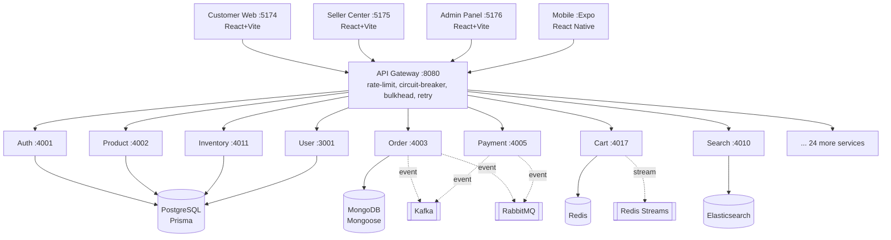

# MUNI Architecture

Verified against the actual codebase on 2026-08-21. Ports, ORMs, and topic names below are
read directly from source (`app.ts`/`index.ts` entry files, `.env.example`, `topics.ts`,
`topology.ts`) and from the **root `docker-compose.yml` — the single authoritative compose
file** for the whole stack. Not aspirational.

## System overview

## Services

Port is the value the service listens on by default (`process.env.PORT ?? <default>`), and is
the same value used for `PORT`, the published host port in root `docker-compose.yml`, `EXPOSE`
in the service Dockerfile, and the gateway's `<NAME>_SERVICE_URL`. All four are verified in sync.

Every service is containerized in the root `docker-compose.yml` — there is no longer a second
compose file to check. Bring the stack up from the repo root with `npm run docker:up`.

| Service | Port | Entry | DB / ORM |
|---|---|---|---|
| api-gateway | 8080 | `gateway.ts` | — |
| user-service | 3001 | `src/server.js` (only JS service; rest are TS/tsx) | Postgres / Prisma |
| auth-service | 4001 | `src/app.ts` | Postgres / Prisma |
| product-service | 4002 | `src/app.ts` | Postgres / Prisma |
| order-service | 4003 | `src/app.ts` | MongoDB / Mongoose |
| inventory-service | 4004 | `src/index.ts` | Postgres / Prisma (shares `muni_products` with product-service) |
| payment-service | 4005 | `src/app.ts` | Postgres / Prisma |
| shipping-service | 4006 | `src/app.ts` **and** `src/index.ts` (both bind :4006 — see gaps) | — |
| notification-service | 4007 | `src/app.ts` (`src/index.ts` also present) | Postgres / Prisma |
| recommendation-service | 4008 | `src/app.ts` (`src/index.ts` also present) | — |
| analytics-service | 4009 | `src/app.ts` (`src/index.ts` also present) | — |
| search-service | 4010 | `src/app.ts` | Elasticsearch |
| review-service | 4011 | `src/index.ts` | Postgres / Prisma |
| currency-service | 4013 | `src/app.ts` | — |
| tax-service | 4014 | `src/app.ts` | Postgres / Prisma |
| discount-service | 4015 | `src/app.ts` | Postgres / Prisma |
| wishlist-service | 4016 | `src/app.ts` | — |
| cart-service | 4017 | `src/app.ts` | Redis |
| media-service | 4018 | `src/app.ts` | — |
| fraud-service | 4019 | `src/app.ts` | — |
| return-service | 4020 | `src/app.ts` | — |
| dispute-service | 4021 | `src/app.ts` | — |
| marketplace-service | 4022 | `src/app.ts` | — |
| fulfillment-service | 4023 | `src/app.ts` | — |
| checkout-service | 4024 | `src/app.ts` | — |
| chat-service | 4025 | `src/app.ts` | MongoDB / Mongoose |
| buyer-protection-service | 4026 | `src/app.ts` | — |
| advertising-service | 4027 | `src/app.ts` | — |
| seller-education-service | 4028 | `src/app.ts` | — |
| qa-service | 4029 | `src/app.ts` | — |
| loyalty-service | 4030 | `src/app.ts` | — |
| container-service | 4031 | `src/app.ts` | Postgres / Prisma |
| support-service | 4032 | `src/app.ts` | Postgres / Prisma |
| pricing-service | 4033 | `src/app.ts` | — |

Port 4012 is unallocated. `wholesale` and `tracking` are gateway route aliases onto
`order-service` (4003) and `shipping-service` (4006) respectively, not separate services.

## API Gateway resilience (real config, not illustrative)

Source: `backend/api-gateway/src/resilience/*`, `src/middleware/rate-limit.middleware.ts`.

- **Rate limiter** — Redis-backed sliding window (`INCR`+`PEXPIRE`), falls back to an in-process
  map if Redis is down. Role-tiered: `ROLE_CUSTOMER`/anonymous 100 req/60s, `ROLE_SELLER`
  1000 req/60s, `ROLE_ADMIN`/`ROLE_SUPER_ADMIN` 5000 req/60s.
- **Circuit breaker** — per-service, 3-state (`CLOSED → OPEN → HALF_OPEN`). Trips after **5
  consecutive failures**, stays open **30s**, then allows one probe request in `HALF_OPEN`
  (any failure there re-opens immediately).
- **Bulkhead** — per-service concurrency cap: **20** for `payment`, **50** default for everything
  else. Queue up to 100 waiters, 5s queue timeout, then reject with 503.
- **Retry** — up to 3 attempts, exponential backoff (1s → 2s → 4s, capped 10s, ±10% jitter).
  Only retries network errors and 5xx; never retries an open circuit or a 4xx.

## Async messaging — three separate systems, each for a different purpose

**Kafka** (`backend/infrastructure/kafka/topics.ts`) — durable, replayed event log. 21 topics
(`auth-events`, `product-events`, `order-events`, `payment-events`, `analytics-events`, etc.),
each with typed event keys, e.g. `order.created`, `payment.succeeded`, `inventory.stock_low`,
`dispute.opened`. Failed messages route to `dead-letter-queue`.

**RabbitMQ** (`backend/infrastructure/rabbitmq/topology.ts`) — narrower domain-event bus with
its own retry pipeline: `muni.events` (topic exchange) → per-service queue; a handler throwing
republishes to `muni.events.retry` with a TTL, which dead-letters back into `muni.events` for
redelivery. After `MAX_RETRIES` (3, delays 5s/30s/2min) it lands in `muni.events.dlx` →
`muni.events.dlq`. Only 4 routing keys currently defined: `order.created`, `order.cancelled`,
`payment.completed`, `inventory.low_stock`.

**Redis Streams** (`backend/infrastructure/redis/streams.ts`) — lower-volume, real-time,
consumer-group based. Streams: `cart-updates`, `order-tracking`, `fraud-alerts`, `price-drops`,
`stock-alerts`, `dispute-chat`, `clickstream`.

25 of the 32 services import from at least one of these three (grep for `kafka|rabbitmq|amqp`
across `backend/services`).

## Data stores

| Store | Used by | Purpose |
|---|---|---|
| PostgreSQL | auth, product, inventory, user, container (Prisma, one schema per service) | primary relational data |
| MongoDB | order, chat (Mongoose) | document data |
| Redis | cart, gateway rate-limiter, sessions | cache, ephemeral state |
| Elasticsearch | search-service | full-text search |

Prisma's `$queryRaw` is used selectively where the query builder can't express it — e.g. `SELECT
... FOR UPDATE` row locking in `inventory-service/src/index.ts` and a recursive CTE for category
trees in `product-service/src/services/category.service.ts`.

## Frontend & mobile

| App | Port (dev) | Stack |
|---|---|---|
| customer-web | 5174 | React 18 + Vite, client-rendered (no SSR) |
| seller-center | 5175 | React 18 + Vite |
| admin-panel | 5176 | React 18 + Vite |
| mobile | Expo dev server | React Native 0.74 + Expo Router (file-based routes under `mobile/app/`) |

## Decision: who owns the fulfillment lifecycle

**order-service owns it. fulfillment-service owns rider operations and cash-on-delivery.**

Two services carried a parcel lifecycle. order-service's `SubOrder` runs
`pending → processing → picked_up → in_transit → out_for_delivery → delivered`;
fulfillment-service's `Fulfillment` runs `PENDING → ASSIGNED → PICKING → PACKED →
HANDED_TO_CARRIER → PICKED_UP → IN_TRANSIT → DELIVERED`. Nothing reconciled them,
and nothing created a `Fulfillment` at all.

The decision was made on where the lifecycle is actually depended upon, not on
which service is better named:

| | order-service sub-order | fulfillment-service |
|---|---|---|
| Frontend files reading it | 20, across all three apps | 0 |
| Backend services reading it | 12 — checkout saga, payment split and settlement, returns, disputes, notifications, recommendations, reviews | 0 |
| Created by | the checkout saga, on every order | nothing |
| Verified end to end | Stage 6 and Stage 7, live | never reachable |

Sub-order state is also load-bearing for money: payment-service settles vendor
shares against it, return-service reads `deliveredAt` from it to decide the
14-day window, and payout eligibility keys off delivery. Moving that authority
would have meant migrating four money paths onto a lifecycle no client has ever
called. Retiring the duplicate is the smaller and safer change, and it is the
one that leaves a single source of truth.

### What each service owns now

**order-service** — the commercial order, its per-seller sub-orders, and the
customer- and seller-facing fulfillment status, including `trackingNumber`,
`carrier`, `shippedAt` and `deliveredAt`. It is the only writer of that state
and the only thing that publishes `order.delivered`.

**fulfillment-service** — the operational execution of a delivery: the rider
who is carrying a parcel, the digital signature taken at the door, and the
cash-on-delivery ledger reconciled per rider per day. None of this exists
anywhere else. A `Fulfillment` is a *delivery job* attached to a sub-order, not
a second opinion about the order's status.

When a rider advances a job, fulfillment-service **projects** the outcome onto
order-service rather than holding a competing status. The sub-order is what the
customer and seller see, so it is what has to move.

### What was retired

`PATCH /api/v1/fulfillment/:id/status` and `POST /api/v1/fulfillment/:id/tracking`
are gone as externally reachable routes. They were the duplicate lifecycle, no
client called them, and the gateway never routed them. Tracking belongs to the
sub-order, which is where every client already reads it.

## Known gaps / inconsistencies found while verifying this doc

- ~~**Port collisions on defaults**~~ — *resolved.* `inventory-service` moved to `4004` and
  `container-service` to `4031`, so all 33 services plus the gateway now hold distinct ports.
  Verified against `.env.example`, `EXPOSE`, compose `PORT`/published, and the gateway targets.
- ~~**12 services have no Docker Compose entry**~~ — *resolved.* The root `docker-compose.yml`
  containerizes all 33 services plus the `api-gateway`. The second, conflicting
  `backend/docker-compose.yml` has been deleted.
- ~~**Two services owned a parcel lifecycle**~~ — *resolved.* See the decision above:
  order-service is the authority, fulfillment-service projects rider outcomes onto it, and
  the duplicate status and tracking routes have been removed.
- **Stale compose files under `backend/infrastructure/docker/`**: `docker-compose.yml` builds
  from `../../services/api-gateway`, a path that does not exist (the gateway lives at
  `backend/api-gateway`), covers only 10 services, and declares no datastores. Its `.prod.yml`
  overlay contains `build: undefined` ten times. Both parse but cannot build. `README.md` and
  `docs/Deployment_Guide.md` still direct users to this broken stack instead of the repo root.
- **Duplicate entry points**: `shipping-service`, `notification-service`, `recommendation-service`,
  and `analytics-service` each have both `src/app.ts` and `src/index.ts`; `package.json` only
  points `start`/`dev` at one of them, so the other is dead code worth removing or is a leftover
  from a migration.
- **user-service is the only service in JavaScript** (`src/server.js`), and the only one whose
  default port (3001) doesn't follow the `40xx` convention used everywhere else.
- **Two mobile source trees** coexist: `mobile/app/` + `mobile/src/` (Expo Router app) and a
  separate `mobile/muni-app/src/`. Worth confirming which is the active app before treating both
  as current.
